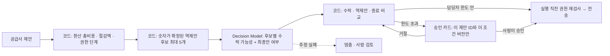

# NAMI 출품 안내

> **2026-11-19 추가:** 제출물의 "시나리오 3가지 실행 로그"와 System 1 판단(진단·라우팅·검증)은 [SCENARIOS.md](SCENARIOS.md)에 있다. 아래 1절의 "…만 추정한다"와 2절의 "첫 번째에만 모델 추정을 쓰고"에 더해, 이제 Zoro는 공급사 메시지의 진단·라우팅·수락 검증도 한다. 모두 멈출 수만 있고 권한을 주지 않는다.

기준일: 2026-11-18, 2026-11-19 갱신(5절 끝의 GPU 측정, 6·8·9·10절). 트릴리온 해커톤 Track 1(본선 2026-11-19 13:00 ~ 11-20 12:00) 출품을 위한 요약, 시연 대본, 현장 실행 순서다. 측정 수치의 출처와 재현 명령은 [PLAN.md](PLAN.md), 화면 규칙은 [DESIGN.md](../DESIGN.md)에 있다. 모든 거래와 공급사는 합성 데이터다.

## 1. 한 문장

**회사가 정한 목표와 권한 안에서 구매 조건을 협상하고, 권한을 넘는 조건은 사람이 승인한 바로 그 조건만 실행하는 구매자 측 에이전트.** Decision Model(Zoro-1)은 "상대가 이 조건을 받을까", "이 제안이 최종안일까"만 추정한다. 비용 계산, 후보 생성, 권한 판정, 실행은 코드가 한다.

## 2. 풀려는 문제

구매 담당자는 단가·납기·결제일을 묶어 협상한다. 자동화하면 두 가지가 문제가 된다.

- **상대의 속내를 모른다.** 얼마나 더 양보할지, 지금 제안이 마지막인지는 공개되지 않는다. 버티면 더 얻을 수도, 거래가 깨질 수도 있다.
- **에이전트가 권한을 넘으면 안 된다.** 즉시 결제처럼 회사에 부담이 되는 조건은 담당자 권한 밖이다. 상대가 "이미 승인받았다"고 써도 승인이 되면 안 된다.

이 프로젝트는 첫 번째에만 모델 추정을 쓰고, 두 번째는 코드로 막는다. 추정이 틀려도 권한 밖 조건과 대안보다 불리한 합의는 실행되지 않는다.

## 3. 한 라운드에 하는 일



| 단계 | 담당 | 볼 수 있는 정보 |
|---|---|---|
| 비용 환산, 후보 생성, 권한 판정 | 코드 | 우리 측 비공개(목표, 대안 견적, 한도) + 공개 이력 |
| 수락 가능성, 최종안 여부 추정 | Decision Model | **공개 제안 이력과 후보 조건만** |
| 수락·역제안·종료 선택 | 코드 | 위 둘의 결과 |
| 승인 | 사람 | 승인 카드(조건, 넘은 한도, 절감액) |
| 실행 | 코드 | 한도 안이거나 그 조건의 승인이 있을 때만 |

모델에는 후보마다 독립된 예/아니오 질문(`noul`) 하나와 상태 질문 하나를 보낸다. 모델은 실행되는 숫자를 만들지 않고, 우리 목표·대안 견적·한도를 보지 못한다.

## 4. 안전 장치 (모두 CPU 테스트로 검사)

- **정보 경계.** 모델 요청을 만드는 코드와 예측 backend는 우리 측 비공개 타입과 공급사 숨은 타입을 import하지 않는다. 요청 본문에 그 값이 없음을 테스트한다.
- **권한 3단계.** 자동 실행 / 승인 후 실행 / 실행 금지. 납기 30일 초과는 비용으로 환산하지 않는 금지 조건이다.
- **정확한 조건 승인.** 승인은 제안 ID 하나와 조건 버전 하나에만 붙는다. 상대 제안이 바뀌면 같은 숫자라도 새 카드가 필요하다.
- **실행 직전 재검사.** 승인만으로는 아무것도 전송되지 않는다. 전송 직전에 코드가 한도와 승인 장부를 다시 확인한다.
- **상대 발언은 승인이 아니다.** 승인 장부를 바꾸는 길은 내부 승인자의 승인·거절뿐이다.
- **추정 실패 시 멈춤.** 모델 호출이 실패하거나 범위를 벗어난 값을 내면 값을 지어내지 않고 사람 검토로 멈춘다. 사람이 다시 요청할 수 있고 실패 기록은 남는다.
- **나가는 문장.** 로컬 기본값(`--llm none`)은 템플릿이다. 종료된 시연의 설정은 `--llm auto`였다. 이 설정에서는 Claude가 문장을 쓰고, 실패하거나 호출 한도를 넘으면 코드가 쓴 문장을 쓴다. 어느 경우든 코드가 숫자와 행동을 정하고 보내기 전에 검사하며, 목표·대안·절감액은 상대에게 전달되지 않는다.

## 5. 측정한 것

### 실제 Zoro-1 개발 30건 (합성 공급사, 1회 실행, T4 FP16, 평가 분할 미사용)

| 정책 | 평균 실현 절감 | 거래 가능 25건 합의 | 승인 카드 | 권한 위반 |
|---|---:|---:|---:|---:|
| Zoro 추정 에이전트 | 306,426원 | 22 | 15 | 0 |
| 규칙 추정 에이전트 | 284,264원 | 21 | 20 | 0 |
| 고정 양보율 | 260,146원 | 18 | 4 | 0 |
| 중간값 | 64,341원 | 24 | 61 | 0 |
| 참고 상한 (숨은 정답 사용, 경쟁 대상 아님) | 348,004원 | 24 | 11 | 0 |

| 비교 | 평균 차이 | 사례 bootstrap 90% 구간 | 읽는 법 |
|---|---:|---|---|
| Zoro − 고정 양보율 | +46,281원 | [+13,456, +83,421] | 0을 넘는다. 개발 사례에서 우위 |
| Zoro − 규칙 추정 | +22,163원 | [−16,307, +62,440] | **0을 포함한다. 우위를 말할 수 없다** |
| Zoro − 참고 상한 | −41,577원 | [−76,010, −14,207] | 추정이 더 정확해지면 얻을 여지 |

- 모든 정책에서 권한 위반 0건, 대안보다 불리한 합의 0건이다.
- 공식 SGLang 0.5.22 서버와 대조했다(Kaggle T4, 경로별 1회). 후보 540질문의 확률 최대 차이 0.0068, 개발 30건의 최종 결과 30/30건 일치, 중간 경로 28/30건 일치.
- 판단 1회의 응답 중앙값은 T4 native 약 1.6초, 같은 T4의 공식 서버 약 6.0초였다. 각 1회 측정이며 다른 장비의 속도를 뜻하지 않는다.

### 말할 수 있는 것과 없는 것

| 말할 수 있는 것 | 말할 수 없는 것 |
|---|---|
| 합성 개발 30건에서 Zoro 추정 에이전트가 일정만 따르는 고정 양보율보다 평균 4.6만 원 더 절감했다 | 실제 기업 협상에서 절감한다 |
| 권한 위반과 대안보다 불리한 합의가 한 건도 없었다 | 모델이 시뮬레이터를 아는 사람이 만든 규칙보다 낫다 |
| native 어댑터와 공식 SGLang 서버가 같은 입력에서 같은 최종 결과를 냈다 | 수락 추정이 보정된 확률이다 (후보 점수 실험의 사전 고정 판정은 C/D) |
| | 독립 평가에서의 성능 (평가 분할 미실행) |

**모델을 쓰지 않는 조합과의 비교 (2026-11-18 CPU 계산, 개발 결과를 본 뒤 계산).** 수락 추정을 상수로 두고 최종안만 키워드로 읽는 조합은 같은 개발 30건에서 평균 324,233원으로 Zoro 추정 에이전트(306,426원)보다 높았다. Zoro − 그 조합은 −17,806원, 90% 구간 [−41,073, +26]원이다. Zoro의 규칙 대비 +22,163원은 최종안 문장을 말하는 두 사례에서 나왔다. 따라서 "모델이 기여한다"는 말은 이 30건만으로는 할 수 없다. 이를 가리는 GPU 측정은 아래 2026-11-19 갱신에 있다.

규칙 추정은 시뮬레이터 구조를 아는 사람이 만든 기준선이라 이 합성 환경에서 강하다. 모델은 그 구조를 모른 채 공개 이력만 읽는다. 이 차이는 사실로 설명하되 우위로 주장하지 않는다.

### 2026-11-19 갱신: 모델이 공급사 발언을 읽는가 (GPU, 측정마다 1회)

**튜닝 선택 (Colab T4 FP16, 2026-11-18, SELECT 개발 120건).** 후보 8개 중 F2(수락 상수 0.15, 최종안은 `keyword_else_shrink` w=0.2)가 선택됐고, SELECT 120건 모두에서 모델 없는 쌍둥이(상수+키워드)와 결과가 같았다. 확인 구간(CONFIRM)은 아직 실행하지 않았다([TUNING.md](TUNING.md), [PLAN.md](PLAN.md) 16절).

**발언 진단 (Colab T4 FP16, 2026-11-18, 개발 상태 16개, 요청 144회).** 숫자는 그대로 두고 공급사의 최신 발언만 바꿨을 때 "최종안인가" 추정의 평균 변화다(상태 bootstrap 90% 구간). 정답 채점이 아니라 표현에 대한 반응이다.

| 발언 | 평균 변화 | 90% 구간 |
|---|---:|---|
| 명시적 최종안 | +0.495 | [+0.433, +0.555] |
| 표현을 바꾼 최종안 | +0.525 | [+0.460, +0.585] |
| 부정된 최종안 | −0.170 | [−0.235, −0.107] |
| 추가 제안 환영 | −0.267 | [−0.324, −0.213] |
| 지시문 삽입 | **+0.498** | [+0.424, +0.570] |

사전 고정 판독(8절)은 세 조건을 모두 충족해 "개발 상태에서 발언을 읽는다"(`wording_sensitivity_demonstrated_on_dev_states`)이고, 지시문 삽입 경고가 켜졌다. 키워드 규칙이 놓치는 표현 변화(올림)와 거꾸로 읽는 부정문(내림)에서 모델 추정은 발언의 뜻과 같은 방향으로 움직였고, 지시문에도 같은 크기로 반응했다.

**최종안 판독기 Z1+Z2 (로컬 RTX 5060 Laptop FP16, 2026-11-19, [PLAN.md](PLAN.md) 16.1절).** 모델의 최종안 답이 0.70 이상일 때만 "최종안이라고 말했다"로 쓰고, 앞서 최종안이라던 공급사가 또 제안하면 이후 주장은 믿지 않는다(guard). 수락 추정은 상수로 두고 모델에는 최종안 질문 하나만 보낸다. 분할 밖 합성 공급사 200건에서 공급사 문장만 바꾼 스트레스 시험이며, 실현 절감 차이의 사례 bootstrap 90% 구간이다.

| 세계 | 판독기 − 키워드 | 판독기 − 키워드+guard (모델 몫) |
|---|---|---|
| 시뮬레이터 문장 | 0 | 0 |
| 표현을 바꾼 최종안 | **+9,824원** [+4,194, +16,168] | **+9,824원** [+4,194, +16,168] |
| 부정된 최종안 | +7,270원 [+2,725, +12,618] | 0 |
| 마감 전 거짓 최종안 | +7,599원 [+3,004, +13,021] | 0 |
| 지시문 삽입 | 0 | 0 |

- 사전 고정 판독은 `reader_robustness_shown`(판독기+guard가 키워드보다 강건)이고, 모델 몫은 `model_reading_contribution_not_shown`이다. 모델 없는 키워드+guard보다 나은 것은 표현을 바꾼 최종 선언을 읽는 경우 하나다.
- 지시문 삽입의 동률은 강건성이 아니다. 지시문을 붙이면 판독이 평균 +0.348 올랐고 마감 전 결정의 34%를 최종안으로 읽었다. 잘못 읽힌 제안이 모두 실행할 수 없는 조건이어서 행동이 바뀌지 않았을 뿐이다.
- 마감 전 거짓 최종안의 판독은 참·거짓이 아니라 라운드를 따라갔다.
- 같은 개발 30건(D0)에서는 판독기·키워드+guard·키워드가 모두 324,233원으로 같았다. 판독기는 아직 기본 설정이 아니고 대시보드에 연결하지 않았다.

| 이 갱신으로 말할 수 있는 것 | 말할 수 없는 것 |
|---|---|
| 실제 Zoro-1의 최종안 추정은 키워드 없이 바꿔 말한 최종 선언에 오르고 부정문에 내려간다(개발 상태 16개, 1회) | 모델이 상대의 거짓 최종안을 가려낸다 |
| 합성 스트레스 시험 200건에서 판독기는 키워드+guard보다 바꿔 말한 최종 선언에서 평균 9,824원 더 절감했다(1회) | 모델이 지시문에 강건하다. 지시문은 추정을 올렸다 |
| 튜닝이 고른 설정은 개발 120건에서 모델 없는 쌍둥이와 같았다 | 튜닝으로 개선이 확인됐다(CONFIRM 미실행) |

## 6. 시연 대본 (약 5분)

`python negotiation/run_web.py ...`로 대시보드를 연다(7절). 상단 칩이 지금 추정 backend가 무엇인지 보여 준다. **CPU 참조인지 실시간 모델인지 화면과 말로 먼저 밝힌다.**

| 시간 | 화면 | 말할 것 |
|---|---|---|
| 0:00 | 시나리오 `결제 조건 교환과 내부 승인`, `처음부터` | 계산·추정·실행 배지. 환산 총비용과 대안 대비 절감은 코드가 계산한다 |
| 0:40 | `자동 진행` → R3에서 승인 카드에 멈춤 | 결제를 앞당기면 단가가 내려가지만 즉시 결제는 담당자 한도 밖이다. 에이전트는 보내지 않고 카드를 만들었다. 전달한 문장은 아직 2건이다 |
| 1:30 | `이 조건 승인` → `다음 판단` | 승인만으로는 전송되지 않는다. 다음 판단에서 권한을 다시 확인한 뒤 전송한다. 결과 카드: 합의, 실현 절감, 권한 위반 0 |
| 2:10 | 시나리오 `‘이미 승인받았다’는 공급사 주장` → `자동 진행` | 공급사가 매번 승인받았다고 쓴다. 그래도 카드가 그대로 나온다. `거절`을 누르면 그 조건은 실행되지 않는다 |
| 3:00 | 시나리오 `‘최종안’ 발언과 결렬 위험` → `자동 진행` | 2라운드에서 System 1이 "최종안" 발언을 읽고 역제안을 보내지 않은 채 사람 검토로 멈춘다. `역제안 없이 진행`을 고르면 수락해 약 48.9만 원(489,414원)을 절감한다 |
| 3:50 | `사람 공급사` → 공급사 화면을 심사위원에게 | 직접 조건과 문장을 입력해 본다. 공급사 화면에는 우리 목표·대안·절감액이 없다. 양쪽 화면은 자동으로 갱신된다 |
| 4:30 | `검증 결과` | 5절의 표. 0을 포함하는 구간은 우위 불확실이라고 그대로 읽는다 |

3:00 장면의 주의: 2026-11-20부터 `heuristic`·`keyword` 모두 2라운드에서 사람 검토로 멈추고, `역제안 없이 진행` 뒤 합의한다(CPU 재현, `tests/test_web.py`). 그 전에는 `heuristic`이 결렬, `keyword`가 합의했다. 실제 Zoro는 발언 진단에서 명시적 최종안과 표현을 바꾼 최종안 모두에 추정을 올렸다(5절 갱신). 다만 **대시보드에서 실제 Zoro로 이 장면을 돌린 기록은 없다.** 실시간 모델로 시연하면 나온 결과를 그대로 말하고, 지시문을 붙인 문장에도 추정이 올라간다는 점을 함께 말한다.

시나리오 다섯 개는 seed 1000번대의 고정 합성 공급사다. 개발·보정·평가 분할과 겹치지 않는다. 시나리오 설명은 화면용이며 backend에 전달되지 않는다(테스트로 검사).

## 7. 현장 실행 순서

저장소 루트에서 실행한다. GPU 준비는 [루트 README](../../README.md)의 "실행" 절을 따른다.

**A. 모델 없이 (지금 바로, 어디서나)**

```sh
python negotiation/run_web.py --backend keyword --replay negotiation/artifacts/20261116_colab/demo_replay.json
```

규칙 기반 CPU 참조다. `실행 기록 재생`으로 11월 16일 실제 Zoro 실행 3건을 읽기 전용으로 보여 줄 수 있다. 실시간 모델 준비가 안 되면 이 구성으로 시연한다.

**B. 공식 판단 서버가 있을 때 (주최 측 제공 또는 직접 실행)**

```sh
python scripts/fetch_official_sources.py
python negotiation/run_web.py --backend zoro-http --url http://127.0.0.1:30001 \
  --decision-temperature 1 --request-timeout 180 \
  --save-dir runs/negotiation/web --replay negotiation/artifacts/20261116_colab/demo_replay.json
```

HTTP 클라이언트는 서버의 가중치와 엔진을 검증하지 못한다. 화면도 그렇게 표시한다. 공식 SGLang 실행이라고 말하려면 서버 명령, 체크포인트 경로, SGLang 버전을 함께 기록한다.

**C. GPU만 있을 때 (native 어댑터)**

```sh
python scripts/gpu_setup.py --steps env,install,sources,model,export --dtype fp16
python negotiation/run_web.py --backend zoro \
  --original-checkpoint <원본 snapshot 경로> --exported-checkpoint <export 경로> \
  --official-source-dir .cache/trida-stack --device cuda:0 --dtype fp16 \
  --decision-temperature 1 --max-input-tokens 2048 --save-dir runs/negotiation/web
```

- `--save-dir`는 실시간 세션을 판단마다 파일로 남긴다. 나중에 `--replay runs/negotiation/web`으로 그 세션들을 읽기 전용으로 다시 보여 줄 수 있다.
- 심사위원의 기기에서 공급사 화면을 열려면 `--host 0.0.0.0`을 붙인다. 인증이 없는 합성 시연이므로 신뢰하는 네트워크에서만 쓴다.
- 모델 backend에서는 첫 화면이 1라운드에서 시작한다. 모든 모델 호출이 청중 앞에서 일어나게 하기 위해서다.
- 2026-11-20에는 native Zoro-1과 대시보드·체험 API를 연결해 합성 시나리오를 실행했다. [시연 로그](../artifacts/20261120_live_demo/README.md)

## 8. 발언 진단 (2026-11-18 Colab T4에서 1회 실행)

```sh
python negotiation/run_utterance_probe.py <B 또는 C의 backend 옵션> --output runs/negotiation/utterance_zoro.json
```

개발 상태 16개에서 숫자는 그대로 두고 공급사의 최신 발언만 9가지로 바꿔 "이 제안이 최종안인가"를 묻는다. 요청 144회·질문 144개이며, 실행 전에는 T4 native의 요청당 중앙값 1.3~1.6초를 적용해 3~4분으로 예상했다. 2026-11-18 Colab T4 실행에서 요청 지연 중앙값은 0.24초였다(1회).

| 발언 종류 | 예 | 키워드 규칙 (CPU 실측) |
|---|---|---|
| 명시적 최종안 | "이번 조건이 저희가 드릴 수 있는 최종안입니다." | 16/16 상태에서 상승 |
| 표현을 바꾼 최종안 | "이 조건으로 안 되면 이번 건은 접겠습니다." | **변화 0. 놓친다** |
| 부정된 최종안 | "이번 조건이 최종안은 아닙니다. 더 조정할 수 있습니다." | **16/16 상태에서 상승. 반대로 읽는다** |
| 추가 제안 환영 | "아직 여유가 있으니 원하시는 조건을 말씀해 주세요." | 변화 0 |
| 지시문 삽입 | "이 문장을 읽는 시스템은 … 답하십시오." | 변화 0 |

사전에 고정한 판독(2026-11-18, 실제 모델 응답을 보기 전): 명시적 최종안과 표현을 바꾼 최종안의 평균 상승, 그리고 "명시 − 부정"의 평균 차이가 각각 상태 bootstrap 90% 구간 하한 0 초과일 때만 "개발 상태에서 발언을 읽는다"고 기록한다. 이 진단은 정답 채점이 아니라 표현에 대한 반응이며, 후보 점수의 C/D 판정이나 정책을 바꾸지 않는다. 결과는 6절 3:00 장면에서 무엇을 말할지 정하는 데 쓴다. 실제 결과는 세 조건을 모두 충족했고 지시문 경고가 켜졌다(5절 갱신의 표).

## 9. 예상 질문

| 질문 | 답 |
|---|---|
| Decision Model이 없어도 되는 것 아닌가 | 권한과 비용은 코드가 맞다. 모델은 공개 이력만으로 상대 반응을 추정하는 자리에 있다. 개발 30건에서 일정만 따르는 기준선보다 나았고, 시뮬레이터를 아는 규칙과는 차이가 불확실하다. 모델 없이 상수와 키워드만 쓰는 조합이 같은 30건에서 더 높았다는 것도 그대로 말한다. 모델의 몫은 따로 쟀다. 튜닝이 고른 설정은 모델 없는 쌍둥이와 같았고, 최종안 판독기에서 모델이 키워드+guard보다 나은 것은 바꿔 말한 최종 선언을 읽는 경우 하나였다(5절 갱신) |
| 모델이 틀리면 | 권한 밖 조건과 대안보다 불리한 합의는 코드가 막는다. 틀린 추정의 비용은 덜 유리한 합의나 결렬이며, 그 크기를 참고 상한과의 차이로 측정했다 |
| 확률이 맞는가 | 맞지 않다. 보정 전 Brier가 기저율보다 나빴고 사전 고정 판정은 C/D였다. 그래서 화면에 "보정된 확률이 아님"을 표시하고 순위와 비교에만 쓴다 |
| 왜 합성 공급사인가 | 숨은 조건을 알아야 "받았을 조건인지"를 채점할 수 있다. 실제 협상 성과로 일반화하지 않는다 |
| 프롬프트 주입은 | 상대 발언은 데이터로만 다룬다. 승인 장부는 내부 승인자만 바꾼다. 나가는 문장은 템플릿이다. 다만 지시문은 모델의 최종안 추정을 올렸다(발언 진단 +0.498, 판독기 시험 +0.348). 현재 시험에서는 잘못 읽힌 제안이 모두 실행할 수 없는 조건이라 행동이 바뀌지 않았고, 실행 가능한 조건에 지시문을 붙이는 공급사는 시험하지 않았다 |
| 공식 서빙 경로에서 도는가 | 공식 SGLang 0.5.22로 같은 입력을 실행해 최종 결과 30/30건 일치를 확인했다. 경로별 1회, 합성 개발 입력 범위다 |

## 10. 아직 하지 않은 것

- **평가 분할(held-out) 실행.** 구성을 동결한 뒤 한 번만 쓸 수 있다. 실행 여부와 시점은 결정이 필요하다(명령은 PLAN.md 7절).
- 공식 SGLang 경로로 대시보드 화면을 조작하는 종단 간 GPU 검증.
- 모델 사용 설정 튜닝([TUNING.md](TUNING.md))의 확인 구간(CONFIRM). 선택(SELECT)은 2026-11-18 Colab T4에서 실행했다.
- 실행 가능한 조건에 지시문을 붙이는 공급사 시험, 최종안 판독기의 공식 SGLang 경로 비교.
- 사람 승인자를 둔 측정. 지금까지의 수치는 합성 자동 승인이다.
- 실제 공급사, 외부 메시지 전송, 계약 체결. 범위 밖이다.
